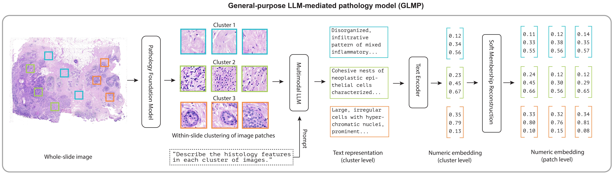

# GLMP

**Mitigating Batch Effects in Histopathology via Language-Mediated Robust Embedding Generation**

Yishu Zhang, Shushan Wu, Zhenzhong Zhang, Didong Li, Huaxiu Yao, Yun Li, Iain Carmichael, Katherine A. Hoadley, Hongtu Zhu, Di Wu, Daiwei Zhang · CVPR Findings 2026

[Paper](https://openaccess.thecvf.com/content/CVPR2026F/papers/Zhang_Mitigating_Batch_Effects_in_Histopathology_via_Language-Mediated_Robust_Embedding_Generation_CVPRF_2026_paper.pdf)



GLMP (General-purpose LLM-mediated Pathology model) generates histology patch embeddings through intermediate biological descriptions. A pathology foundation model groups patches within each slide, a multimodal LLM describes representative patches from each group, and a text encoder embeds those descriptions. Soft cluster memberships combine the group embeddings into patch-level representations, reducing sensitivity to institution-specific batch effects.

## Usage

Install dependencies and configure Hugging Face and Google API credentials:

```bash
pip install -r requirements.txt
export HF_TOKEN="your-hugging-face-token"
export GOOGLE_API_KEY="your-google-api-key"
./run.sh
```

The demo uses Virchow2, Gemini 2.5 Pro, and Gemini Embedding on a breast tissue slide. The runner downloads the slide and saves results under `Samples/`. The description prompt is in `prompt.txt`.

## Citation

```bibtex
@inproceedings{zhang2026mitigating,
  title={Mitigating Batch Effects in Histopathology via Language-Mediated Robust Embedding Generation},
  author={Zhang, Yishu and Wu, Shushan and Zhang, Zhenzhong and Li, Didong and Yao, Huaxiu and Li, Yun and Carmichael, Iain and Hoadley, Katherine A. and Zhu, Hongtu and Wu, Di and Zhang, Daiwei},
  booktitle={Proceedings of the IEEE/CVF Conference on Computer Vision and Pattern Recognition (CVPR) Findings},
  month={June},
  year={2026},
  pages={5201--5213},
  url={https://openaccess.thecvf.com/content/CVPR2026F/html/Zhang_Mitigating_Batch_Effects_in_Histopathology_via_Language-Mediated_Robust_Embedding_Generation_CVPRF_2026_paper.html}
}
```
